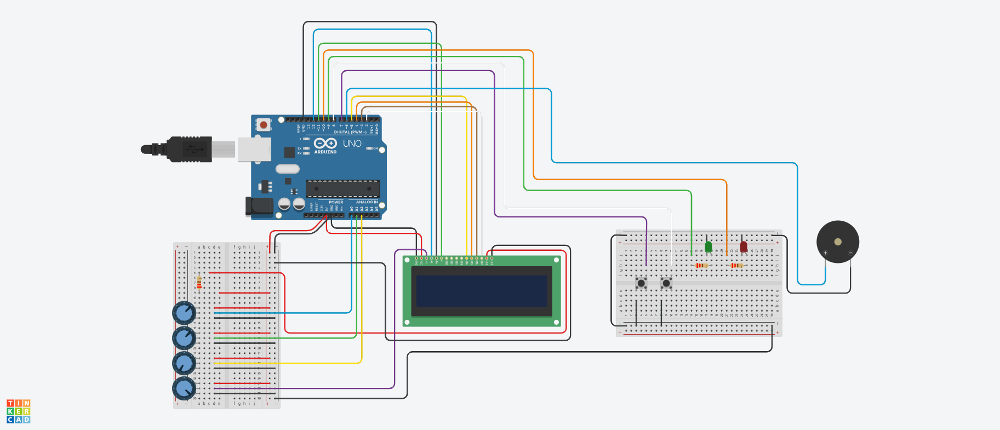
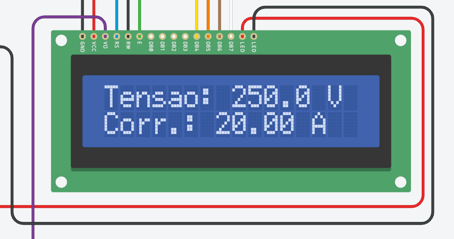
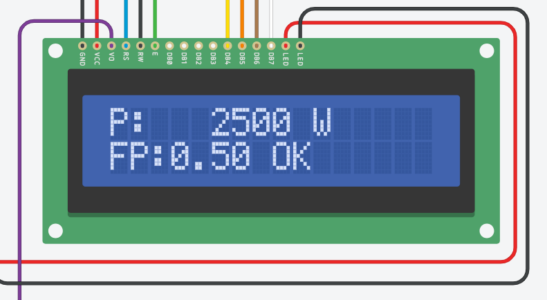
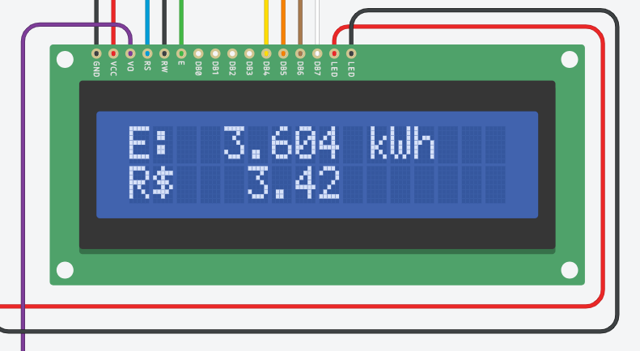
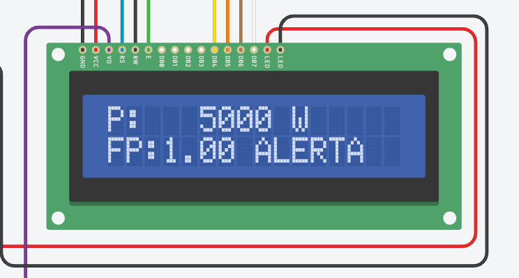
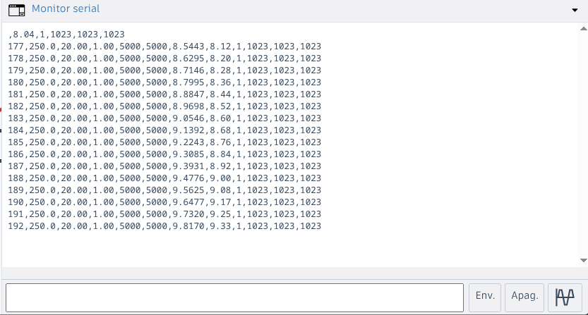

# Medidor de Energia com Alerta (Arduino + Tinkercad)

Simulação de um mini medidor inteligente de energia elétrica. O projeto lê **tensão**, **corrente** e **fator de potência**, calcula **potência**, **energia (kWh)** e **custo estimado**, mostra tudo em um LCD 16x2 e dispara **alerta visual e sonoro** em caso de sobrecarga.

**Simulação no Tinkercad:** https://www.tinkercad.com/things/8ZMFmGwBbQ6-medidor-energia/editel?returnTo=https%3A%2F%2Fwww.tinkercad.com%2Fdashboard%2Fdesigns%2Fall&sharecode=vFWHd9HEb-9MpA71Rns034F9BeqFoaf5xgIx_FBSMvo



## Funcionalidades

- Leitura de tensão, corrente e fator de potência (3 potenciômetros que simulam os sensores)
- Média de 8 amostras por leitura
- Potência aparente `S = V · I` e potência ativa `P = S · FP`
- Energia acumulada `E = ∫P dt` em kWh e custo `E × tarifa`
- Alerta de sobrecarga com **histerese**: LED vermelho e buzzer intermitente acima de 3000 W
- 3 telas no LCD, alternadas por botão: tensão/corrente, potência/FP, energia/custo
- Botão de reset do consumo acumulado
- Saída serial em CSV, pronta para registro de dados
- Modo diagnóstico que mostra no LCD os valores brutos (0 a 1023) das entradas analógicas

## Capturas da simulação

| Tela 1: tensão e corrente | Tela 2: potência e fator de potência |
|---|---|
|  |  |

| Tela 3: energia e custo | Alerta de sobrecarga |
|---|---|
|  |  |

Saída do Monitor Serial:



## Como o circuito está organizado

| Parte | Função |
|---|---|
| Arduino Uno + LCD 16x2 | Cálculo e visualização |
| **Placa A** (protoboard) | Entradas simuladas: 3 potenciômetros de medição e 1 de contraste do LCD |
| **Placa B** (protoboard) | Painel de controle: 2 botões, 2 LEDs com resistor |
| Buzzer piezo | Ligado por fios, fora da protoboard |

Mais detalhes em [`docs/ligacoes.md`](docs/ligacoes.md).

## Componentes

| Qtd | Componente |
|---|---|
| 1 | Arduino Uno R3 |
| 1 | LCD 16x2 (sem I2C) |
| 2 | Placa de ensaio pequena |
| 4 | Potenciômetro (tensão, corrente, fator de potência, contraste) |
| 3 | Resistor 220 Ω (backlight do LCD e um por LED) |
| 2 | Botão (pushbutton) |
| 1 | LED verde |
| 1 | LED vermelho |
| 1 | Piezo (buzzer) |

## Pinagem do Arduino

| Função | Pino |
|---|---|
| LCD RS / E | D12 / D11 |
| LCD DB4 / DB5 / DB6 / DB7 | D5 / D4 / D3 / D2 |
| Potenciômetro de tensão | A0 |
| Potenciômetro de corrente | A1 |
| Potenciômetro de fator de potência | A2 |
| Botão TELA | D7 |
| Botão RESET | D8 |
| LED verde (normal) | D9 |
| LED vermelho (alerta) | D10 |
| Buzzer | D6 |

## Como simular

1. Abra a simulação no Tinkercad (ou monte o circuito conforme [`docs/ligacoes.md`](docs/ligacoes.md)) e cole o conteúdo de `src/medidor_energia.ino` no editor de código, em modo texto.
2. Inicie a simulação e abra o **Monitor Serial**.
3. Gire os potenciômetros. A escala é: tensão de 0 a 250 V, corrente de 0 a 20 A e fator de potência de 0,50 a 1,00.
4. O alerta dispara quando `V × I × FP` passa de **3000 W** e só desliga abaixo de 2850 W. Exemplo: 220 V, 15 A e FP 0,92 dão cerca de 3036 W.
5. Aperte o botão TELA para trocar de tela e o botão RESET para zerar o kWh.

Os casos de teste estão em [`docs/testes.md`](docs/testes.md).

## Parâmetros ajustáveis

No topo de `src/medidor_energia.ino`:

| Constante | O que faz |
|---|---|
| `V_MAX`, `I_MAX` | Fundo de escala dos potenciômetros |
| `FP_MIN`, `FP_MAX` | Faixa do fator de potência |
| `TARIFA` | Tarifa em R$/kWh (valor de exemplo) |
| `LIMITE_W` | Potência que dispara o alerta |
| `HISTERESE` | Alerta desliga abaixo de `LIMITE_W × HISTERESE` |
| `ACEL` | Aceleração do tempo: 1 s real = 60 s simulados |
| `MODO_DIAGNOSTICO` | `true` mostra no LCD os valores brutos de A0, A1 e A2 |

## Saída serial

Uma linha por segundo, em CSV, a 9600 baud:

```
t_s,V,A,FP,S_VA,P_W,E_kWh,custo_R$,alerta,rawA0,rawA1,rawA2
```

## Estrutura do repositório

```
medidor-energia/
├── .gitignore
├── LICENSE
├── README.md
├── src/
│   └── medidor_energia.ino
├── docs/
│   ├── ligacoes.md
│   ├── teoria.md
│   ├── testes.md
│   └── img/
│       ├── circuito.png
│       ├── lcd-tela1-tensao-corrente.png
│       ├── lcd-tela2-potencia.png
│       ├── lcd-tela3-energia-custo.png
│       ├── alerta-sobrecarga.png
│       └── monitor-serial.png
└── data/
    └── exemplo_log.csv
```

## Documentação

- [Teoria e fórmulas](docs/teoria.md)
- [Ligações e montagem](docs/ligacoes.md)
- [Casos de teste](docs/testes.md)

## Roadmap

- [ ] Trocar os potenciômetros por sensores reais (ZMPT101B e ACS712)
- [ ] ESP32 com envio para dashboard (MQTT e Grafana)
- [ ] Registro em cartão SD
- [ ] Tarifa com bandeiras e horário de ponta
- [ ] Cálculo de valor RMS por amostragem da forma de onda
- [ ] Próximos projetos: quadro de comando com intertravamento e climatização com controle de carga

## Licença

MIT. Veja o arquivo [LICENSE](LICENSE).
