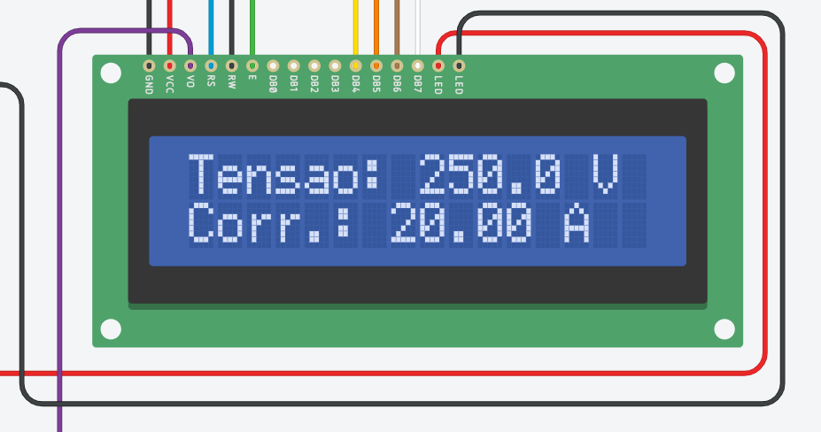
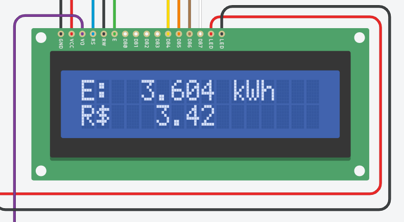

# Casos de teste

Todos os testes foram pensados para a simulação no Tinkercad. Para ler os valores reais durante o teste, confira a tela de tensão e corrente do LCD e o Monitor Serial.

## Regra de cálculo

`P = V × I × FP`. O alerta liga acima de **3000 W** e desliga abaixo de **2850 W**.

## Alerta de sobrecarga

| Nº | Tensão | Corrente | FP | P esperada | Resultado esperado |
|---|---|---|---|---|---|
| 1 | 0 V | 0 A | 0,50 | 0 W | LED verde aceso, buzzer mudo |
| 2 | 250 V | 20 A | 1,00 | 5000 W | LED vermelho aceso, verde apagado, buzzer intermitente |
| 3 | 250 V | 20 A | 0,50 | 2500 W | LED verde aceso (abaixo do limite) |
| 4 | 220 V | 15 A | 0,92 | 3036 W | LED vermelho aceso, buzzer intermitente |
| 5 | 250 V | 12,5 A | 1,00 | 3125 W | LED vermelho aceso |

## Histerese

| Nº | Situação | Resultado esperado |
|---|---|---|
| 6 | Alerta ativo e P cai para cerca de 2900 W | Vermelho continua aceso (ainda acima de 2850 W) |
| 7 | Alerta ativo e P cai abaixo de 2850 W | Verde acende, vermelho e buzzer desligam |
| 8 | Alerta desligado e P sobe para cerca de 2900 W | Verde continua aceso (ainda abaixo de 3000 W) |

## Energia e custo

Com `ACEL = 60` e `TARIFA = 0,95`:

| Nº | Situação | Resultado esperado |
|---|---|---|
| 9 | P constante em 3000 W durante 10 s reais | Cerca de 0,500 kWh e R$ 0,48 |
| 10 | Apertar RESET na tela de energia | kWh e custo voltam a zero |

## Botões e telas

| Nº | Ação | Resultado esperado |
|---|---|---|
| 11 | Apertar TELA na tela 1 | Mostra potência (W) e FP, com "OK" ou "ALERTA" |
| 12 | Apertar TELA na tela 2 | Mostra energia (kWh) e custo (R$) |
| 13 | Apertar TELA na tela 3 | Volta para tensão e corrente |

## Entradas analógicas

Com `MODO_DIAGNOSTICO = true`, o LCD mostra os valores brutos (0 a 1023) de A0, A1 e A2. Ao girar cada potenciômetro, só o valor correspondente deve variar:

| Potenciômetro | Valor lido |
|---|---|
| Pot 1 | A0 |
| Pot 2 | A1 |
| Pot 3 | A2 |

## Como registrar um log

1. Rode a simulação e abra o Monitor Serial.
2. Gire os potenciômetros por alguns segundos, incluindo uma passagem pelo alerta.
3. Copie as linhas do Monitor Serial para `data/exemplo_log.csv`, mantendo a linha de cabeçalho no topo.

O cabeçalho é impresso uma única vez, quando a simulação inicia. Para capturá-lo, pare e inicie a simulação de novo antes de copiar o log.

## Resultados observados

| Caso | Entrada | Resultado observado | Evidência |
|---|---|---|---|
| 2 | 250 V, 20 A, FP 1,00 | 5000 W e "ALERTA" no LCD |  |
| 3 | 250 V, 20 A, FP 0,50 | 2500 W e "OK" no LCD |  |
| 11 a 13 | Botão TELA | As três telas aparecem em sequência: tensão e corrente, potência e FP, energia e custo |   |

Na tela de energia, 3,604 kWh correspondem a R$ 3,42 com a tarifa de R$ 0,95/kWh, como esperado.

O Monitor Serial confirma o alerta ativo (coluna `alerta` igual a 1) com 5000 W, e o kWh cresce a cada linha:

Os demais casos (1, 4 a 10) ainda não têm captura registrada.
