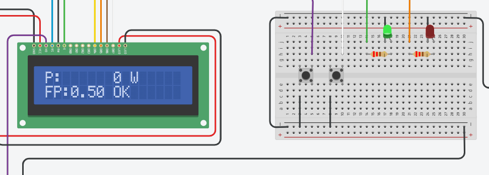
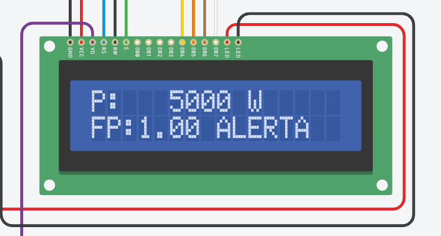
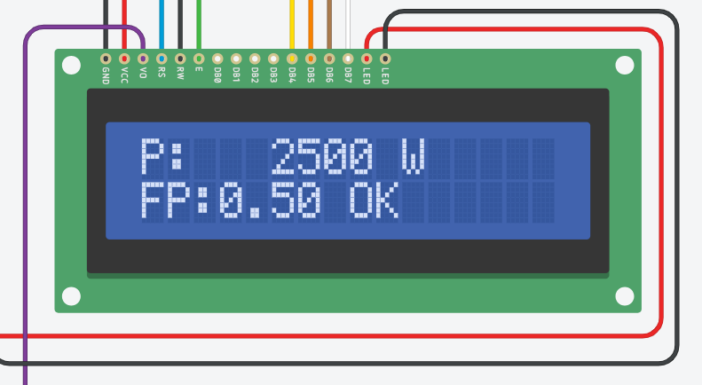
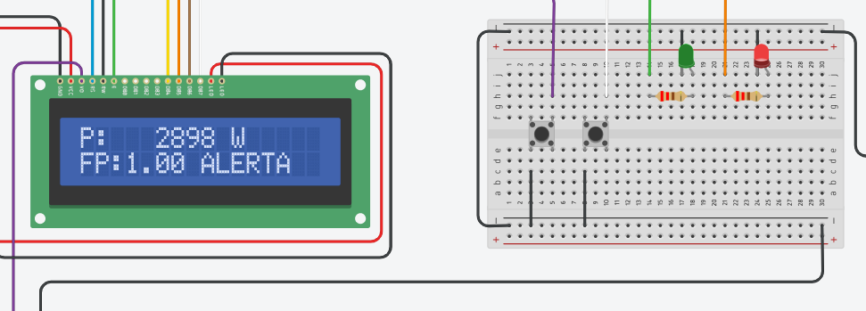
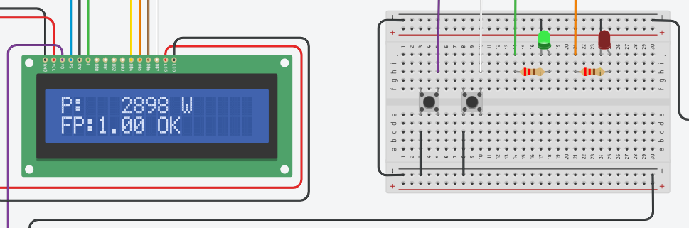
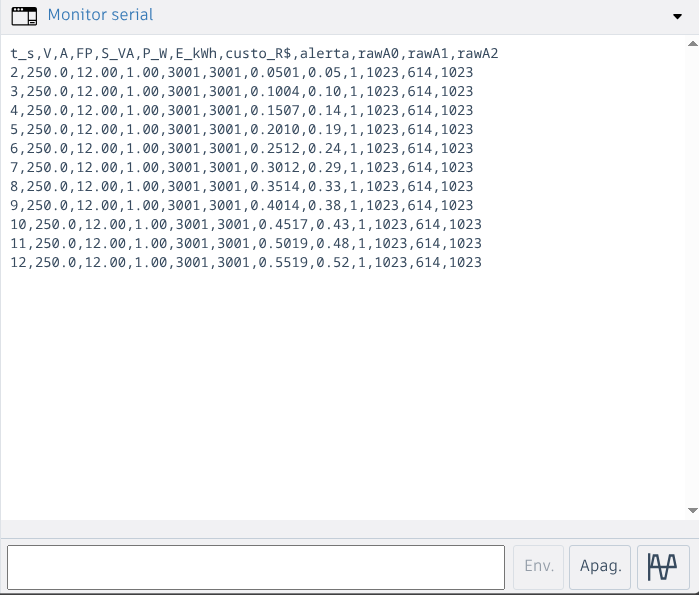
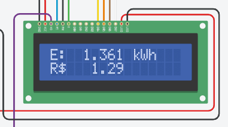
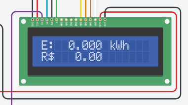
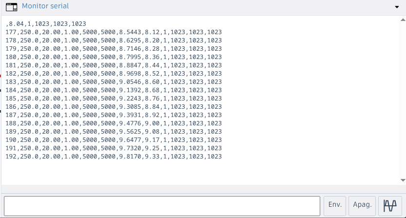

# Casos de teste

Todos os testes foram pensados para a simulação no Tinkercad. Para ler os valores reais durante o teste, confira a tela de tensão e corrente do LCD e o Monitor Serial.

## Regra de cálculo

`P = V × I × FP`. O alerta liga acima de **3000 W** e desliga abaixo de **2850 W**.

## Alerta de sobrecarga

| Nº | Tensão | Corrente | FP | P esperada | Resultado esperado |
|---|---|---|---|---|---|
| 1 | 0 V | 0 A | 0,50 | 0 W | LED verde aceso, buzzer mudo |
| 2 | 250 V | 20 A | 1,00 | 5000 W | LED vermelho aceso, verde apagado, buzzer intermitente |
| 3 | 250 V | 20 A | 0,50 | 2500 W | LED verde aceso (abaixo do limite) |
| 4 | 220 V | 15 A | 0,92 | 3036 W | LED vermelho aceso, buzzer intermitente |
| 5 | 250 V | 12,5 A | 1,00 | 3125 W | LED vermelho aceso |

## Histerese

| Nº | Situação | Resultado esperado |
|---|---|---|
| 6 | Alerta ativo e P cai para cerca de 2900 W | Vermelho continua aceso (ainda acima de 2850 W) |
| 7 | Alerta ativo e P cai abaixo de 2850 W | Verde acende, vermelho e buzzer desligam |
| 8 | Alerta desligado e P sobe para cerca de 2900 W | Verde continua aceso (ainda abaixo de 3000 W) |

## Energia e custo

Com `ACEL = 60` e `TARIFA = 0,95`:

| Nº | Situação | Resultado esperado |
|---|---|---|
| 9 | P constante em 3000 W durante 10 s reais | Cerca de 0,500 kWh e R$ 0,48 |
| 10 | Apertar RESET na tela de energia | kWh e custo voltam a zero |

## Botões e telas

| Nº | Ação | Resultado esperado |
|---|---|---|
| 11 | Apertar TELA na tela 1 | Mostra potência (W) e FP, com "OK" ou "ALERTA" |
| 12 | Apertar TELA na tela 2 | Mostra energia (kWh) e custo (R$) |
| 13 | Apertar TELA na tela 3 | Volta para tensão e corrente |

## Entradas analógicas

Com `MODO_DIAGNOSTICO = true`, o LCD mostra os valores brutos (0 a 1023) de A0, A1 e A2. Ao girar cada potenciômetro, só o valor correspondente deve variar:

| Potenciômetro | Valor lido |
|---|---|
| Pot 1 | A0 |
| Pot 2 | A1 |
| Pot 3 | A2 |

## Como registrar um log

1. Rode a simulação e abra o Monitor Serial.
2. Gire os potenciômetros por alguns segundos, incluindo uma passagem pelo alerta.
3. Copie as linhas do Monitor Serial para `data/exemplo_log.csv`, mantendo a linha de cabeçalho no topo.

O cabeçalho é impresso uma única vez, quando a simulação inicia. Para capturá-lo, pare e inicie a simulação de novo antes de copiar o log.

## Resultados observados

Todos os casos abaixo foram executados na simulação do Tinkercad. Os valores de entrada ficam próximos dos planejados, porque os potenciômetros não permitem ajuste exato.

| Nº | Entrada | Esperado | Observado | Status |
|---|---|---|---|---|
| 1 | 0 V, 0 A, FP 0,50 | 0 W, LED verde aceso | 0 W, "OK", verde aceso e vermelho apagado | Aprovado |
| 2 | 250 V, 20 A, FP 1,00 | 5000 W, alerta | 5000 W, "ALERTA" | Aprovado |
| 3 | 250 V, 20 A, FP 0,50 | 2500 W, "OK" | 2500 W, "OK" | Aprovado |
| 4 | ~220 V, ~15 A, FP 0,92 | ~3036 W, alerta | 3073 W, "ALERTA", vermelho aceso | Aprovado |
| 5 | 250 V, ~12,5 A, FP 1,00 | ~3125 W, alerta | 3099 W, "ALERTA", vermelho aceso | Aprovado |
| 6 | Alerta ativo, P em ~2900 W | Vermelho continua aceso | 2898 W, "ALERTA", vermelho aceso | Aprovado |
| 7 | Alerta ativo, P abaixo de 2850 W | Verde acende, vermelho apaga | 2698 W, "OK", verde aceso | Aprovado |
| 8 | Alerta desligado, P em ~2900 W | Verde continua aceso | 2898 W, "OK", verde aceso | Aprovado |
| 9 | ~3000 W por 10 s | ~0,500 kWh e R$ 0,48 | 3001 W: 0,5019 kWh e R$ 0,48 em 10 s | Aprovado |
| 10 | RESET na tela de energia | kWh e custo voltam a zero | De 1,361 kWh e R$ 1,29 para 0,000 kWh e R$ 0,00 | Aprovado |
| 11 | TELA na tela 1 | Potência e FP | Tela de potência exibida | Aprovado |
| 12 | TELA na tela 2 | Energia e custo | Tela de energia exibida | Aprovado |
| 13 | TELA na tela 3 | Volta para tensão e corrente | Tela de tensão e corrente exibida novamente | Aprovado |

O som do buzzer não aparece em captura de tela. Ele foi conferido ouvindo a simulação nos casos em que o alerta está ativo.

### Evidências

**Casos 1 a 3: alerta e ausência de carga**

| Caso 1: sem carga | Caso 2: 5000 W | Caso 3: 2500 W |
|---|---|---|
|  |  |  |

**Casos 4 e 5: alerta acima do limite**

| Caso 4: 3073 W | Caso 5: 3099 W |
|---|---|
|  |  |

**Casos 6 a 8: histerese**

Os casos 6 e 8 têm a mesma potência (2898 W) e resultados diferentes, o que depende do estado anterior do alerta.

| Caso 6: alerta mantido | Caso 7: alerta desligado | Caso 8: alerta não religa |
|---|---|---|
|  |  |  |

**Caso 9: energia acumulada**

Com 3001 W constantes, o kWh cresce cerca de 0,05 por segundo (3,001 kW × 60/3600 h). Dez segundos depois do RESET, o log marca 0,5019 kWh e R$ 0,48.

**Caso 10: reset do consumo**

| Antes do RESET | Depois do RESET |
|---|---|
|  |  |

**Registro serial**

O Monitor Serial registra a subida e a descida do alerta: a coluna `alerta` passa a 1 em t = 6 s, com 4050 W, e volta a 0 em t = 12 s, quando a potência cai para 162 W. O kWh só cresce enquanto há carga.

